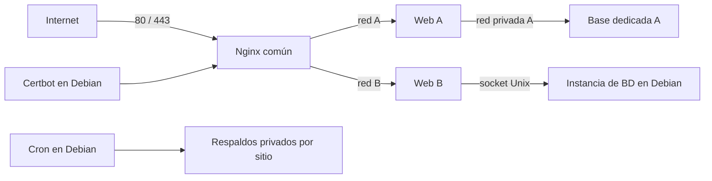

# DockerWS

Hospedaje de varios sitios web en un servidor Debian con Docker Compose, Nginx y Let's Encrypt. Incluye un asistente Bash para crear sitios, bases de datos opcionales y respaldos automáticos desde el host.

Pensado para servidores administrados por una misma persona o equipo. Cada aplicación tiene su Compose, red frontal y credenciales. Solo el proxy publica los puertos 80 y 443.

## Funcionalidad

| Tipo de sitio | Base de datos disponible |
| --- | --- |
| WordPress | MySQL o MariaDB |
| Laravel | MySQL, MariaDB, PostgreSQL, SQLite o ninguna |
| PHP | MySQL, MariaDB, PostgreSQL, SQLite o ninguna |
| Estático | Ninguna |

MySQL, MariaDB y PostgreSQL pueden ejecutarse en **un contenedor dedicado al sitio** o en **una instancia compartida instalada en Debian**. En ambos casos cada aplicación recibe una base y un usuario propios. SQLite utiliza un archivo persistente por sitio.

Versiones predeterminadas: PHP 8.4, MySQL 8.4 LTS, MariaDB 11.4, PostgreSQL 17. Se admiten PHP 8.3–8.5. Las versiones se configuran en [config/defaults.json](config/defaults.json); revisar compatibilidad de la aplicación antes de cambiarlas. Las etiquetas reciben actualizaciones de su rama, no están fijadas por digest.

El asistente crea **el alojamiento de la aplicación**: no descarga WordPress/Laravel, no importa datos, no ejecuta migraciones y no cambia el DNS. Así sirve tanto para aplicaciones nuevas como para migraciones.

## Arquitectura



Las redes frontales son distintas por sitio; el proxy se conecta a todas. Las bases dedicadas usan redes internas sin puertos publicados. Las compartidas usan sockets Unix montados de solo lectura, con autenticación propia por aplicación. PHP/Apache se ejecuta como UID/GID `33:33`, sin capabilities, y con el código montado de solo lectura. Solo los directorios de datos necesarios son escribibles.

El control operativo es Bash. Los generadores y respaldos usan Python 3 de Debian y su biblioteca estándar, sin paquetes pip. Los archivos `compose.yaml` generados están escritos en JSON, que Compose admite como YAML, para evitar dependencias de serialización.

## Inicio rápido

Requisitos: Debian 13 o 12, acceso root, DNS público del dominio y puertos 80/443 disponibles. Un único checkout administra el servidor. Los ejemplos usan `/opt/dockerws`; también puedes usar otra ruta absoluta sin espacios. Mantén el checkout bajo control de administradores: cron ejecutará estos scripts como root.

1. Clona este repositorio en `/opt/dockerws` y entra en ese directorio.
2. Instala dependencias e integra las tareas automáticas:

   ```bash
   sudo ./host/install-debian.sh
   sudo ./host/install-automation.sh
   ```

   El instalador usa el repositorio oficial de Docker, conserva la zona horaria y se detiene si encuentra paquetes Docker incompatibles. No instala servidores de bases de datos en Debian; eso solo hace falta si eliges modalidad `host`.

3. Crea un sitio con el asistente:

   ```bash
   sudo ./scripts/create-site.sh
   ```

   Pregunta dominio, alias, tipo de aplicación, PHP, necesidad y motor de BD, y modalidad. Si eliges la instancia del host, ofrece crear en ella la base y el usuario. PostgreSQL recibe reglas de autenticación específicas; consulta [bases de datos](docs/DATABASES.md).

4. Copia la aplicación en `sites/DOMINIO/app/` siguiendo [la guía de aplicaciones](docs/APPLICATIONS.md). PHP y estáticos incluyen una página mínima. WordPress y Laravel requieren su código antes de arrancar.

5. Arranca la aplicación y actualiza el proxy:

   ```bash
   sudo ./scripts/stack.sh site-up example.com
   sudo ./scripts/stack.sh proxy-up
   ```

6. Apunta los registros A y, si aplica, AAAA al servidor. Solicita el certificado:

   ```bash
   sudo ./scripts/issue-cert.sh example.com admin@example.com --dry-run
   sudo ./scripts/issue-cert.sh example.com admin@example.com
   sudo certbot renew --dry-run
   ```

   Todos los alias declarados también deben resolver al servidor. El primer comando prueba la emisión sin guardar un certificado de producción. Antes de tener certificado, el sitio devuelve HTTP 503 excepto en el desafío ACME. Después redirige HTTP a HTTPS. El timer de Certbot renueva y su deploy-hook valida y recarga Nginx automáticamente.

7. Genera y verifica un primer respaldo:

   ```bash
   sudo ./scripts/backup.sh
   ```

   El cron lo ejecuta diariamente a las 02:15, hora del servidor. Conserva 30 días en `/var/backups/dockerws`, con directorios `0700` y archivos `0600`. Consulta [respaldos y restauración](docs/BACKUPS.md).

Cada vez que agregues un sitio, ejecuta `proxy-up` para que Nginx se conecte a la nueva red. Esto puede recrear el proxy y cortar conexiones brevemente; planifica altas en una ventana adecuada. Las renovaciones de certificados usan una recarga, sin recrearlo.

## Uso no interactivo

```bash
# WordPress + MariaDB dedicada
sudo ./scripts/create-site.sh --domain blog.example.com --type wordpress \
  --database mariadb --db-mode container

# Laravel + PostgreSQL compartido en Debian
sudo ./scripts/create-site.sh --domain app.example.com --type laravel \
  --database postgres --db-mode host
sudo ./scripts/provision-host-db.sh app.example.com

# PHP con SQLite y un sitio estático
sudo ./scripts/create-site.sh --domain small.example.com --type php --database sqlite
sudo ./scripts/create-site.sh --domain www.example.com --type static
```

Opciones adicionales: `--alias` (repetible), `--id`, `--php`, `--socket-dir`, `--socket-name`, `--db-port`. El modo no interactivo solo genera archivos; usa `provision-host-db.sh` explícitamente si eliges el host. Puedes generar archivos sin root para revisarlos, pero en el servidor debes crearlos con sudo para asignar los permisos de escritura de la aplicación.

Un dominio, alias o ID duplicado produce un error. No se sobrescriben sitios, contraseñas, bases o usuarios existentes. Los ID/nombres SQL se derivan del dominio y son independientes entre sitios.

## Estructura

```text
config/defaults.json      Valores públicos predeterminados
config/local.json         Cambios locales opcionales, ignorados por Git
host/                     Instalación de Debian, cron y deploy-hook
images/php-apache/        Imagen PHP compartida, extensiones y Apache
templates/                Configuración inicial de WordPress y estáticos
proxy/                    Nginx y configuración generada
scripts/                  Asistente, operación, certificados y respaldos
sites/<dominio>/          Instancias locales generadas, ignoradas por Git
  site.json               Metadatos sin contraseñas
  compose.yaml            Servicios, redes, volúmenes y límites
  runtime.env             Variables privadas de aplicación
  secrets/                Credenciales administrativas/inicialización
  app/                    Código de la aplicación
  writable/               Datos escribibles para PHP genérico
  data/sqlite/            Archivo SQLite, cuando corresponde
tests/                    Pruebas unitarias e integración con Docker
```

No editar a mano `site.json` para cambiar el motor, dominio o modalidad de un sitio existente: esas operaciones requieren una migración de datos. `compose.yaml` puede adaptarse después de crearlo; el generador nunca lo reescribe. `config/local.json` solo afecta sitios nuevos (excepto opciones operativas como respaldos y la imagen del proxy).

## Operación

```bash
sudo ./scripts/stack.sh list
sudo ./scripts/stack.sh validate
sudo ./scripts/stack.sh site example.com logs --tail=100
sudo ./scripts/stack.sh site example.com exec --user 33:33 web php -v
sudo ./scripts/stack.sh db-up example.com
sudo ./scripts/stack.sh site-stop example.com
sudo ./scripts/stack.sh proxy logs --tail=100
```

`site-stop` detiene también la base dedicada. Para mantenimiento de la aplicación manteniendo la base encendida: `stack.sh site example.com stop web`.

Los límites de memoria son topes, no reservas: web 512 MiB, BD dedicada 768 MiB, proxy 256 MiB. Debes ajustarlos al tráfico, consultas y memoria real; no equivalen a un dimensionamiento garantizado. Una instancia de BD compartida reduce la memoria base de múltiples procesos, aunque su caída afecta a todos sus sitios.

Solo abre al público 80/443 y restringe SSH al origen administrativo, también en el Security Group si utilizas AWS. Nunca publiques 3306/5432 para este diseño. Los puertos publicados por Docker tienen implicaciones específicas para el firewall del host; revisa la [documentación de Docker para Debian](https://docs.docker.com/engine/install/debian/).

Este proyecto no proporciona aislamiento de una máquina virtual por cliente, alta disponibilidad, monitoreo externo ni copia remota de respaldos. Es adecuado para aplicaciones bajo una administración común. [Seguridad y límites](SECURITY.md) · [Hoja de ruta](docs/ROADMAP.md).

## Desarrollo y publicación

```bash
bash tests/check.sh          # Sin daemon; valida Compose si su CLI está instalada
python3 tests/smoke.py       # Opt-in: Docker real, descarga imágenes y construye PHP
```

Las pruebas de integración crean recursos temporales con ID aleatorio y eliminan únicamente esos recursos. No ejecutar sobre un host productivo con recursos limitados. Consulta [la validación](docs/VALIDATION.md) y [cómo contribuir](CONTRIBUTING.md).

El repositorio excluye sitios generados, secretos, respaldos, certificados y configuración local. Antes de publicar revisa `git status --short` y el contenido a añadir; `.gitignore` no elimina información ya presente en el historial. Licencia MIT.
