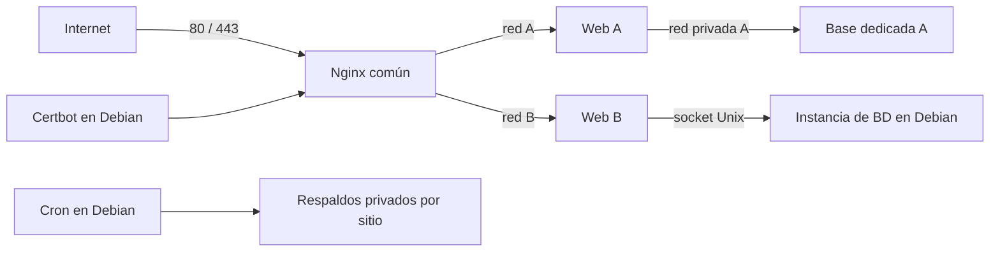

# DockerWS

Hospedaje de varios sitios web en un servidor Debian con Docker Compose, Nginx y Let's Encrypt. Incluye un asistente Bash para crear sitios, bases de datos opcionales y respaldos automáticos desde el host.

Pensado para servidores administrados por una misma persona o equipo. Cada aplicación tiene su Compose, red frontal y credenciales. Solo el proxy publica los puertos 80 y 443.

## Funcionalidad

| Tipo de sitio | Base de datos disponible |
| --- | --- |
| WordPress | MySQL o MariaDB |
| Laravel | MySQL, MariaDB, PostgreSQL, SQLite o ninguna |
| PHP | MySQL, MariaDB, PostgreSQL, SQLite o ninguna |
| Estático | Ninguna |

MySQL, MariaDB y PostgreSQL pueden ejecutarse en **un contenedor dedicado al sitio** o en **una instancia compartida instalada en Debian**. En ambos casos cada aplicación recibe una base y un usuario propios. SQLite utiliza un archivo persistente por sitio.

Versiones predeterminadas: PHP 8.4, MySQL 8.4 LTS, MariaDB 11.4, PostgreSQL 17. Se admiten PHP 8.3–8.5. Las versiones se configuran en [config/defaults.json](config/defaults.json); revisar compatibilidad de la aplicación antes de cambiarlas. Las etiquetas reciben actualizaciones de su rama, no están fijadas por digest.

El asistente crea **el alojamiento de la aplicación**: no descarga WordPress/Laravel, no importa datos, no ejecuta migraciones y no cambia el DNS. Así sirve tanto para aplicaciones nuevas como para migraciones.

## Arquitectura



Las redes frontales son distintas por sitio; el proxy se conecta a todas. Las bases dedicadas usan redes internas sin puertos publicados. Las compartidas usan sockets Unix montados de solo lectura, con autenticación propia por aplicación. PHP/Apache se ejecuta como UID/GID `33:33`, sin capabilities, y con el código montado de solo lectura. Solo los directorios de datos necesarios son escribibles.

El control operativo es Bash. Los generadores y respaldos usan Python 3 de Debian y su biblioteca estándar, sin paquetes pip. Los archivos `compose.yaml` generados están escritos en JSON, que Compose admite como YAML, para evitar dependencias de serialización.

## Inicio rápido

Requisitos: Debian 13 o 12, acceso root, DNS público del dominio y puertos 80/443 disponibles. Un único checkout administra el servidor. Los ejemplos usan `/opt/dockerws`; también puedes usar otra ruta absoluta sin espacios. Mantén el checkout bajo control de administradores: cron ejecutará estos scripts como root.

1. Clona este repositorio en `/opt/dockerws` y entra en ese directorio.
2. Instala dependencias e integra las tareas automáticas:

   ```bash
   sudo ./host/install-debian.sh
   sudo ./host/install-automation.sh
   ```

   El instalador usa el repositorio oficial de Docker, conserva la zona horaria y se detiene si encuentra paquetes Docker incompatibles. No instala servidores de bases de datos en Debian; eso solo hace falta si eliges modalidad `host`.

3. Crea un sitio con el asistente:

   ```bash
   sudo ./scripts/create-site.sh
   ```

   Pregunta dominio, alias, tipo de aplicación, PHP, necesidad y motor de BD, y modalidad. Si eliges la instancia del host, ofrece crear en ella la base y el usuario. PostgreSQL recibe reglas de autenticación específicas; consulta [bases de datos](docs/DATABASES.md).

4. Copia la aplicación en `sites/DOMINIO/app/` siguiendo [la guía de aplicaciones](docs/APPLICATIONS.md). PHP y estáticos incluyen una página mínima. WordPress y Laravel requieren su código antes de arrancar.

5. Arranca la aplicación y actualiza el proxy:

   ```bash
   sudo ./scripts/stack.sh site-up example.com
   sudo ./scripts/stack.sh proxy-up
   ```

6. Apunta los registros A y, si aplica, AAAA al servidor. Comprueba el desafío y solicita el certificado:

   ```bash
   sudo ./scripts/issue-cert.sh example.com --check
   sudo ./scripts/issue-cert.sh example.com
   sudo certbot renew --dry-run
   ```

   Todos los alias declarados también deben resolver al servidor. `--check` publica un token temporal en el webroot de ACME y lo pide para el dominio y cada alias, de dos formas: al proxy local y por el DNS público, siguiendo redirecciones como lo hace Let's Encrypt. Después lo borra. No contacta a Let's Encrypt, así que no depende del entorno staging ni consume límites. `--dry-run` sigue disponible y usa staging.

   Si `--check` informa «DNS sin respuesta» para un registro que acabas de crear, el resolvedor del host puede tener guardada la respuesta negativa de una consulta anterior. La conserva durante el TTL negativo de la zona (el mínimo del SOA, a menudo de 5 minutos a 1 hora), aunque el DNS público ya responda. Compara con `dig +short www.example.com @1.1.1.1`; si ahí ya aparece, vacía la caché con `sudo resolvectl flush-caches` (systemd-resolved) y repite `--check`. `--check` lo sugiere, pero no vacía la caché por su cuenta.

   El correo es opcional (`issue-cert.sh example.com admin@example.com`). Let's Encrypt ya no envía avisos de vencimiento, y con una cuenta ya registrada en el servidor el correo no se usa. Antes de tener certificado, el sitio devuelve HTTP 503, excepto en el desafío ACME. Después redirige HTTP a HTTPS. El timer de Certbot renueva y su deploy-hook valida y recarga Nginx.

   **Con Cloudflare (proxy activado, nube naranja):**

   - El origen no tiene TLS hasta emitir el primer certificado. Si Cloudflare intenta HTTPS hacia el origen, el visitante ve **525** en lugar del 503. Emite primero con el registro en gris (solo DNS) o confirma con `--check` que el desafío pasa a través de Cloudflare.
   - **«Always Use HTTPS»** y las reglas de redirección a HTTPS envían el desafío a `https://` y producen 525. Desactívalas para el primer certificado o excluye `/.well-known/acme-challenge/*`. Lo mismo con reglas de WAF, Bot Fight Mode o desafíos que afecten esa ruta. `--check` detecta Cloudflare en la respuesta y lo indica.
   - Con certificado emitido, usa el modo SSL **Full (strict)**. «Flexible» genera bucles de redirección; «Full» sin `strict` no valida el certificado del origen.
   - Las renovaciones pasan por HTTP-01 igual que la primera emisión: mantén la excepción para `/.well-known/acme-challenge/`.
   - Para registrar la IP real del visitante, agrega un archivo manual, por ejemplo `proxy/conf.d/05-cloudflare-realip.conf`, con `set_real_ip_from` para cada [rango de Cloudflare](https://www.cloudflare.com/ips/) y `real_ip_header CF-Connecting-IP;`. El generador conserva los archivos que no creó.

7. Genera y verifica un primer respaldo:

   ```bash
   sudo ./scripts/backup.sh                    # Todos los sitios con BD
   sudo ./scripts/backup.sh example.com        # Solo un sitio
   ```

   El cron lo ejecuta diariamente a las 02:15, hora del servidor. Conserva 30 días en `/var/backups/dockerws`, con directorios `0700` y archivos `0600`. Consulta [respaldos y restauración](docs/BACKUPS.md).

El contenedor del proxy se llama `dws-proxy`. Cada vez que agregues un sitio, ejecuta `proxy-up` para que Nginx se conecte a la nueva red. Si el proxy está corriendo, `proxy-up` conecta las redes nuevas con `docker network connect`, desconecta las de sitios eliminados, valida con `nginx -t` y recarga, sin recrear el contenedor ni cortar conexiones de los demás sitios. Esas conexiones persisten tras reiniciar el contenedor o el host. `proxy-up --recreate` recrea el proxy como antes; hace falta solo si cambias la imagen de Nginx o la definición del servicio (puertos, montajes). Las renovaciones de certificados usan una recarga, sin recrearlo.

## Uso no interactivo

```bash
# WordPress + MariaDB dedicada
sudo ./scripts/create-site.sh --domain blog.example.com --type wordpress \
  --database mariadb --db-mode container

# Laravel + PostgreSQL compartido en Debian
sudo ./scripts/create-site.sh --domain app.example.com --type laravel \
  --database postgres --db-mode host
sudo ./scripts/provision-host-db.sh app.example.com

# PHP con SQLite y un sitio estático
sudo ./scripts/create-site.sh --domain small.example.com --type php --database sqlite
sudo ./scripts/create-site.sh --domain www.example.com --type static
```

Opciones adicionales: `--alias` (repetible), `--id`, `--php`, `--socket-dir`, `--socket-name`, `--db-port`, y `--scheduler` (solo Laravel: servicio `schedule:work`, sin cron en el host). El modo no interactivo solo genera archivos; usa `provision-host-db.sh` explícitamente si eliges el host. Puedes generar archivos sin root para revisarlos, pero en el servidor debes crearlos con sudo para asignar los permisos de escritura de la aplicación.

Un dominio, alias o ID duplicado produce un error. No se sobrescriben sitios, contraseñas, bases o usuarios existentes.

El ID del sitio y el nombre de la base se derivan del dominio, con un sufijo de 4 caracteres del hash para que sean únicos. Por ejemplo, para `app.example.com`:

| Recurso | Nombre |
|---|---|
| ID del sitio | `app-example-com-2805` |
| Contenedores | `dws-app-example-com-2805-web-1`, `dws-app-example-com-2805-db-1` |
| Base y usuario | `dws_app_example_com_2805` |

Los dominios largos se recortan para que el usuario de MySQL no pase de 32 caracteres. `--id` cambia el ID y los nombres de los contenedores; la base sigue derivándose del dominio. Los sitios creados con versiones anteriores conservan sus nombres (`dockerws-sHASH-web-1`, `dwsHASH`).

## Estructura

```text
config/defaults.json      Valores públicos predeterminados
config/local.json         Cambios locales opcionales, ignorados por Git
host/                     Instalación de Debian, cron, deploy-hook y usuario de despliegue
images/php-apache/        Imagen PHP compartida, extensiones y Apache
templates/                Configuración inicial de WordPress y estáticos
proxy/                    Nginx y configuración generada
scripts/                  Asistente, operación, certificados y respaldos
sites/<dominio>/          Instancias locales generadas, ignoradas por Git
  site.json               Metadatos sin contraseñas
  compose.yaml            Servicios, redes, volúmenes y límites
  compose.d/*.yaml        Overlays opcionales (scheduler, etc.); se cargan después
  runtime.env             Credenciales y valores generados (APP_KEY, DB_*)
  app.env                 Variables propias de la aplicación (correo, idioma…)
  secrets/                Credenciales administrativas/inicialización
  app/                    Código de la aplicación (o enlace a releases/FECHA)
  releases/               Releases atómicos, cuando el sitio los usa
  shared/storage/         storage/ de Laravel compartido entre releases
  writable/               Datos escribibles para PHP genérico
  data/sqlite/            Archivo SQLite, cuando corresponde
tests/                    Pruebas unitarias e integración con Docker
```

No editar a mano `site.json` para cambiar el motor, dominio o modalidad de un sitio existente: esas operaciones requieren una migración de datos. `compose.yaml` puede adaptarse después de crearlo; el generador nunca lo reescribe. Las mejoras posteriores se agregan como overlays en `compose.d/`; ver [adopción en sitios existentes](docs/ADOPTION.md) y [notas de actualización](docs/UPGRADING.md). `config/local.json` solo afecta sitios nuevos (excepto opciones operativas como respaldos y la imagen del proxy).

## Despliegue

```bash
sudo ./scripts/deploy.sh app.example.com --from /srv/dockerws/incoming/app.example.com
sudo ./scripts/deploy.sh app.example.com --ref main
```

En Laravel: mantenimiento, respaldo de la base del sitio, sincronización del código, composer, `migrate --force`, `optimize`, recreación de los contenedores y `artisan up`. Admite ganchos `pre-deploy`/`post-deploy`. Los contenedores siempre se recrean, así que no hace falta reiniciar `web` después. Node no está en la imagen PHP: los assets se compilan fuera. Para desplegar sin dar `sudo` amplio, `host/install-deploy-user.sh` crea una carpeta de subida y una regla de sudo limitada a `deploy.sh`.

Opcionalmente, `deploy.sh DOMINIO --init-releases` cambia el sitio a releases atómicos: el código se prepara con el sitio en línea, las migraciones corren antes de activarlo y `deploy.sh DOMINIO --rollback` vuelve al release anterior si la base lo permite. Detalles en [la guía de aplicaciones](docs/APPLICATIONS.md#desplegar-laravel-y-php).

## Operación

```bash
sudo ./scripts/stack.sh list
sudo ./scripts/stack.sh validate
sudo ./scripts/stack.sh site example.com logs --tail=100
sudo ./scripts/stack.sh site example.com exec --user 33:33 web php -v
sudo ./scripts/stack.sh status                      # Código 1 si algún servicio no corre
sudo ./scripts/stack.sh site-composer app.example.com
sudo ./scripts/stack.sh scheduler-enable app.example.com
sudo ./scripts/stack.sh env-reload app.example.com     # Tras editar app.env o runtime.env
sudo ./scripts/stack.sh db-up example.com
sudo ./scripts/stack.sh db-import example.com dump.sql.gz --confirm-overwrite
sudo ./scripts/stack.sh site-stop example.com
sudo ./scripts/stack.sh site-rename example.com       # Sitio antiguo → nombres legibles (plan; --apply)
sudo ./scripts/stack.sh proxy logs --tail=100
```

`site-up` muestra la salida de la construcción de la imagen solo si falla; usa `site-up DOMINIO --verbose` para verla siempre. `site-stop` detiene también la base dedicada y el scheduler. Para mantenimiento de la aplicación manteniendo la base encendida: `stack.sh site example.com stop web`.

Los límites de memoria son topes, no reservas: web 512 MiB, BD dedicada 768 MiB, proxy 256 MiB. Debes ajustarlos al tráfico, consultas y memoria real; no equivalen a un dimensionamiento garantizado. Una instancia de BD compartida reduce la memoria base de múltiples procesos, aunque su caída afecta a todos sus sitios.

Solo abre al público 80/443 y restringe SSH al origen administrativo, también en el Security Group si utilizas AWS. Nunca publiques 3306/5432 para este diseño. Los puertos publicados por Docker tienen implicaciones específicas para el firewall del host; revisa la [documentación de Docker para Debian](https://docs.docker.com/engine/install/debian/).

Este proyecto no proporciona aislamiento de una máquina virtual por cliente, alta disponibilidad, monitoreo externo ni copia remota de respaldos. Es adecuado para aplicaciones bajo una administración común. [Seguridad y límites](SECURITY.md) · [Hoja de ruta](docs/ROADMAP.md).

## Desarrollo y publicación

```bash
bash tests/check.sh          # Sin daemon; valida Compose si su CLI está instalada
python3 tests/smoke.py       # Opt-in: Docker real, descarga imágenes y construye PHP
```

Las pruebas de integración crean recursos temporales con ID aleatorio y eliminan únicamente esos recursos. No ejecutar sobre un host productivo con recursos limitados. Consulta [la validación](docs/VALIDATION.md) y [cómo contribuir](CONTRIBUTING.md).

El repositorio excluye sitios generados, secretos, respaldos, certificados y configuración local. Antes de publicar revisa `git status --short` y el contenido a añadir; `.gitignore` no elimina información ya presente en el historial. Licencia MIT.
